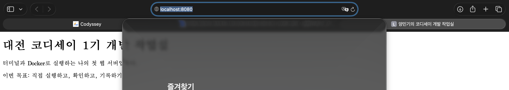
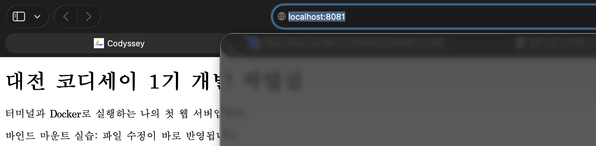

# 개발 작업실 꾸미기

루키마리너 1기_양민기

이번 과제에서는 터미널로 파일과 폴더를 다루고 Docker로 웹 서버를 실행했다. 바인드 마운트와 볼륨 동작을 확인하고, 작업 파일과 수행 기록을 GitHub에 올렸다.

[GitHub 저장소](https://github.com/didthq100-arch/codyssey-workstation)

## 1. 실행 환경

- OS: macOS 26.6.2 / Apple Silicon arm64
- Shell / 터미널: zsh / 맥 기본 터미널
- Docker: 29.9.2 / Docker Desktop
- Git: 2.39.5 (Apple Git-154)

[환경 확인 명령과 출력](docs/logs/01-environment-readable.txt) · [원본 로그](docs/logs/01-environment.txt)

## 2. 진행한 내용

- [x] 터미널에서 폴더와 파일 만들기, 복사, 이름 바꾸기, 삭제
- [x] 파일과 폴더 권한 바꿔보기
- [x] Docker 설치하고 hello-world 실행하기
- [x] Ubuntu 안에서 명령어 입력하고 나와보기
- [x] Dockerfile 만들고 웹페이지 실행하기
- [x] 8080, 8081 포트로 접속하기
- [x] 바인드 마운트로 파일 수정 내용 확인하기
- [x] 컨테이너를 지워도 볼륨에 파일이 남는지 확인하기
- [x] Git 설정하고 VSCode에서 GitHub에 올리기

## 3. 웹페이지 실행

Docker Desktop을 켜두고 터미널에서 작업했다. NGINX를 사용했고, 기본 페이지 대신 작성한 HTML이 나오도록 했다.

~~~dockerfile
FROM nginx:alpine
COPY site/ /usr/share/nginx/html/
EXPOSE 80
~~~

사용한 명령어다. 다시 실행할 때는 이 저장소 폴더에서 입력하면 된다. 같은 이름의 컨테이너가 이미 있으면 이름이나 포트를 바꿔야 한다.

~~~bash
docker build -t codyssey-web:1.0 .
docker run -d --name codyssey-web -p 8080:80 codyssey-web:1.0
curl -i http://localhost:8080
docker run -d --name codyssey-web-bind -p 8081:80 -v "$(pwd)/site:/usr/share/nginx/html:ro" codyssey-web:1.0
curl -i http://localhost:8081
~~~

두 주소 모두 200 OK가 나왔고 브라우저에서도 페이지가 보였다. 8080:80은 맥의 8080번 포트와 컨테이너 안의 80번 포트를 연결하는 뜻이다.

site/index.html의 문장을 바꿨을 때 8081에서는 바뀐 문장이 나왔고 8080에서는 원래 문장이 나왔다. 8081은 내 폴더를 직접 연결했고, 8080은 이미지를 만들 때 복사한 파일을 쓰기 때문이다. 다시 해볼 때도 빌드한 다음 HTML 문장 하나를 바꾸면 비교할 수 있다.

## 4. 볼륨 확인

볼륨에 글을 저장한 다음 컨테이너를 지웠다. 새 컨테이너에 같은 볼륨을 연결하고 읽어봤다. 아래는 실행한 내용 중 일부다.

~~~console
$ docker volume create codyssey-data
codyssey-data
$ docker run -d --name codyssey-volume-before -v codyssey-data:/data ubuntu:24.04 sleep infinity
$ docker exec codyssey-volume-before bash -c 'echo "Codyssey volume persistence test" > /data/note.txt'
$ docker exec codyssey-volume-before cat /data/note.txt
Codyssey volume persistence test
$ docker rm -f codyssey-volume-before
codyssey-volume-before
$ docker run -d --name codyssey-volume-after -v codyssey-data:/data ubuntu:24.04 sleep infinity
$ docker exec codyssey-volume-after cat /data/note.txt
Codyssey volume persistence test
~~~

컨테이너 이름은 바뀌었는데 같은 글이 나왔다. 파일이 볼륨에 남아 있는 것을 확인했다. [전체 과정 캡처](docs/images/05-volume-persistence.png)

## 5. 캡처

- 터미널: [위치·숨김 파일·폴더 생성](docs/images/21-terminal-location-and-hidden-files.png), [파일 생성·복사·이름 변경·삭제](docs/images/22-terminal-file-operations.png)
- 권한: [파일 644→600→644, 폴더 755→700→755](docs/images/14-file-directory-permissions.png). r은 읽기(4), w는 쓰기(2), x는 실행 또는 폴더 진입(1)이다. 이 숫자를 더해서 권한을 표시한다.
- Docker: [설치](docs/images/19-docker-install.png), [hello-world](docs/images/08-hello-world.png), [images·ps·logs](docs/images/09-images-ps-logs.png)
- 컨테이너: [Ubuntu 내부 명령·exit·exec](docs/images/20-ubuntu-exit-exec.png), [stats](docs/images/03-container-stats.png), [stop](docs/images/04-container-stop.png)
- 웹 서버: [소스 작성·빌드 성공](docs/images/18-web-source-and-build.png), [실행·포트·응답](docs/images/06-web-run-and-curl.png)
- 바인드 마운트: [변경 전후](docs/images/01-bind-mount-before-after.png), [8080 원본 유지](docs/images/02-image-copy-original.png)
- Git: [사용자·기본 브랜치 설정](docs/images/13-git-config-and-stage.png), [첫 커밋](docs/images/17-git-first-commit.png), [VSCode에서 GitHub 업로드](docs/images/23-vscode-github-push.png), [연동 로그](docs/logs/02-github-readable.txt)

Git으로 내 컴퓨터에 변경 이력을 저장하고, push로 GitHub에 올렸다. [전체 캡처 폴더](docs/images/)

## 6. 하면서 막혔던 부분

1. **Docker를 설치했는데 명령어가 안 됐다.** command not found가 나왔다. 터미널에 새 설정이 적용되지 않았을 수 있어서 exec zsh -l을 입력했다. 그다음 docker --version과 command -v docker를 입력하니 버전과 경로가 나왔다. [캡처](docs/images/07-docker-path-fix.png)
2. **HTML 파일을 못 찾았다.** cat /index.html을 입력했더니 파일이 없다고 나왔다. 파일 경로를 잘못 적은 것 같아서 cat site/index.html로 바꾸니 내용이 나왔다. 앞에 /를 붙이면 현재 폴더가 아니라 맨 위 경로부터 찾는다는 것을 알게 됐다. [캡처](docs/images/18-web-source-and-build.png)
