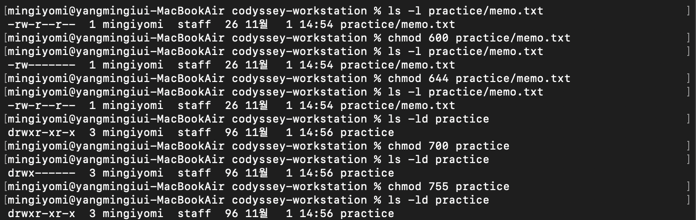
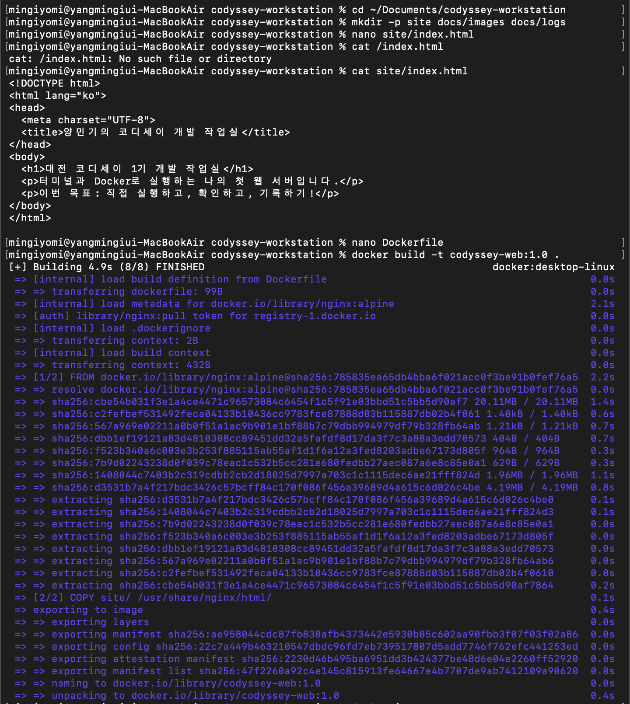
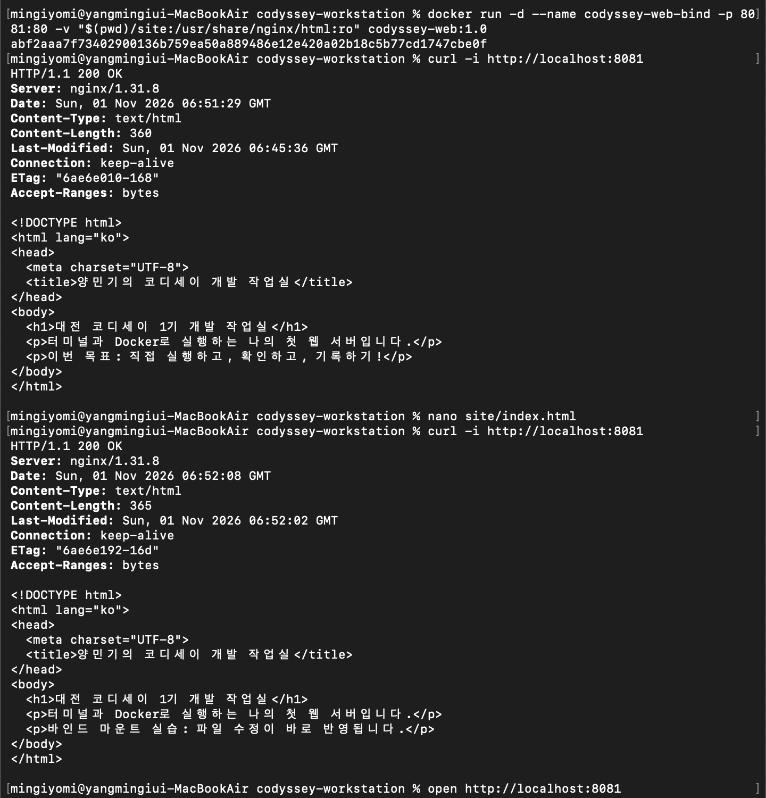
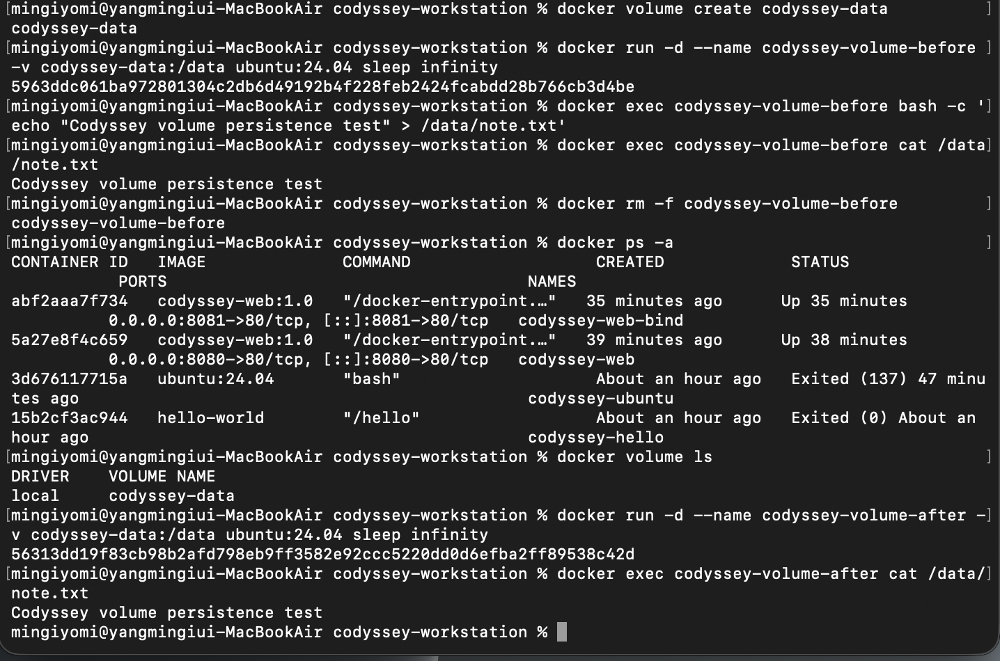

# 내 컴퓨터에 개발자용 작업실 꾸미기

대전 코디세이 1기 · 양민기

터미널에서 파일과 권한을 다루고, Docker로 웹 서버를 실행한 뒤 Git으로 변경 이력을 관리하는 개발 워크스테이션 구축 실습이다. 명령을 실행하는 데서 끝내지 않고 응답, 실행 상태, 파일 변경, 데이터 유지 여부를 확인했다.

> 작성 상태: 실습, 브라우저 캡처 및 로컬 첫 커밋 완료. GitHub 업로드와 VSCode·GitHub 연동 증거는 추가 예정이다. 아래 미완료 항목을 마친 후 제출한다.

## 1. 실행 환경

| 항목 | 확인 결과 |
|---|---|
| 실습일 | 2026-11-01 (Asia/Seoul) |
| OS | macOS 26.6.2, 빌드 25G83 |
| CPU 아키텍처 | Apple Silicon, arm64 |
| 셸 | /bin/zsh |
| 터미널 | macOS 기본 터미널, Apple_Terminal |
| 컨테이너 실행 환경 | Docker Desktop |
| Docker CLI / 엔진 | 29.9.2 / 29.9.2 |
| Docker context | desktop-linux |
| Git | 2.39.5 (Apple Git-154) |
| 웹 서버 기반 이미지 | nginx:alpine |
| 실습 당시 HTTP 서버 응답 | nginx/1.31.8 |
| Ubuntu 이미지 | ubuntu:24.04 |
| Ubuntu 내부 OS 확인 | Ubuntu 24.04.5 LTS |

확인 명령 및 실제 결과 발췌:

~~~console
$ sw_vers
ProductName:            macOS
ProductVersion:         26.6.2
BuildVersion:           25G83

$ uname -m
arm64

$ echo "$SHELL"
/bin/zsh

$ echo "$TERM_PROGRAM"
Apple_Terminal

$ git --version
git version 2.39.5 (Apple Git-154)

$ docker --version
Docker version 29.9.2, build a82e528
~~~

[환경 로그 정리본](docs/logs/01-environment-readable.txt) · [script 기록 원본](docs/logs/01-environment.txt)

원본에는 터미널 화면을 제어하는 문자가 포함되어 있어 정리본을 함께 제공한다. 초기 설치 화면에서는 컨테이너가 0개이고, 이후 기록한 환경 로그에는 실습 결과인 컨테이너 5개가 표시된다. 두 기록의 수집 시점이 다르기 때문이다.

## 2. 수행 체크리스트

- [x] 터미널에서 현재 위치·숨김 파일 목록 확인
- [x] 폴더 이동·생성, 파일 생성·읽기·복사·이름 변경·삭제
- [x] 파일 1개와 디렉토리 1개의 권한 변경 전후 비교
- [x] Docker 설치, CLI 버전 및 엔진 동작 확인
- [x] hello-world 실행
- [x] Ubuntu 내부 명령 실행 및 주 프로그램 종료 관찰
- [x] exec 접속 종료 후 컨테이너 유지 확인
- [x] images, ps, ps -a, logs, stats, start, stop 사용
- [x] Dockerfile 직접 작성, 커스텀 이미지 빌드 및 실행
- [x] 포트 매핑 후 8080·8081 HTTP 응답 확인
- [x] 바인드 마운트 수정 전후 비교
- [x] 볼륨 생성·연결 및 컨테이너 삭제 전후 데이터 유지 검증
- [x] Git 사용자 정보와 기본 브랜치 설정
- [x] 첫 커밋 생성
- [x] 트러블슈팅 2건 기록
- [x] 주소창 포트와 페이지가 표시된 브라우저 캡처 2장 첨부
- [ ] GitHub 저장소 생성 및 push 완료 증거 추가
- [ ] VSCode에서 GitHub 로그인 및 과제 저장소 연동 증거 추가
- [ ] 제출 전 이 문서의 추가 예정 항목 정리

보너스인 Compose와 SSH 인증 설정은 이번 필수 실습 범위에 포함하지 않았다.

## 3. 프로젝트 구성

~~~text
codyssey-workstation/
├── .gitignore
├── Dockerfile
├── README.md
├── practice/
│   └── memo.txt
├── site/
│   └── index.html
└── docs/
    ├── images/
    └── logs/
        ├── 01-environment.txt
        └── 01-environment-readable.txt
~~~

[Dockerfile](Dockerfile) · [웹페이지 소스](site/index.html) · [터미널 실습 파일](practice/memo.txt)

로그에 등장하는 /Users/mingiyomi 경로는 실습 PC의 기록이다. 다른 PC에서는 자신의 저장소 폴더로 이동한 뒤 아래 상대 경로 명령을 사용하면 된다.

## 4. 웹 서버 재현 방법

Docker Desktop을 실행하고, 이 저장소를 내려받은 뒤 저장소 최상위 폴더에서 실행한다.

아래는 동일한 컨테이너 이름이 없는 새 실습 환경 기준이다. 기존에 실습한 PC에서는 이름과 포트 사용 여부를 먼저 확인하고, 충돌하면 새 이름과 사용 가능한 호스트 포트를 지정한다.

~~~bash
docker --version
docker info
docker build -t codyssey-web:1.0 .
docker run -d --name codyssey-web -p 8080:80 codyssey-web:1.0
docker ps
curl -i http://localhost:8080
~~~

브라우저에서 http://localhost:8080 으로 접속한다. macOS에서는 다음 명령으로 열 수 있다.

~~~bash
open http://localhost:8080
~~~

성공 판정은 컨테이너의 Up 상태, HTTP 200 OK 응답, 작성한 HTML 표시이다. 이미지 태그는 갱신될 수 있어 이후 실행 시 기반 패키지 버전과 이미지 ID는 실습 기록과 달라질 수 있다.

현재 저장소의 HTML에는 바인드 마운트 실습 후 문장이 저장되어 있다. 새로 빌드하면 그 문장이 이미지에도 복사된다. 아래의 과거 실습 결과와 비교할 때 이 점을 구분한다.

## 5. 터미널 기본 조작과 경로

프로젝트 폴더를 만들고 이동한 실제 기록:

~~~console
$ mkdir -p ~/Documents/codyssey-workstation
$ cd ~/Documents/codyssey-workstation
$ pwd
/Users/mingiyomi/Documents/codyssey-workstation
$ mkdir practice
$ touch practice/memo.txt
$ ls -la practice
total 0
drwxr-xr-x  3 mingiyomi  staff  96 11월  1 14:53 .
drwxr-xr-x@ 3 mingiyomi  staff  96 11월  1 14:53 ..
-rw-r--r--  1 mingiyomi  staff   0 11월  1 14:53 memo.txt
~~~

파일 작성·읽기·복사·이름 변경·삭제 기록:

~~~console
$ echo "My first Codyssey mission" > practice/memo.txt
$ cat practice/memo.txt
My first Codyssey mission
$ cp practice/memo.txt practice/memo-copy.txt
$ mv practice/memo-copy.txt practice/memo-backup.txt
$ ls -la practice
total 16
drwxr-xr-x  4 mingiyomi  staff  128 11월  1 14:56 .
drwxr-xr-x@ 3 mingiyomi  staff   96 11월  1 14:53 ..
-rw-r--r--  1 mingiyomi  staff   26 11월  1 14:55 memo-backup.txt
-rw-r--r--  1 mingiyomi  staff   26 11월  1 14:54 memo.txt
$ rm practice/memo-backup.txt
$ ls -la practice
total 8
drwxr-xr-x  3 mingiyomi  staff  96 11월  1 14:56 .
drwxr-xr-x@ 3 mingiyomi  staff  96 11월  1 14:53 ..
-rw-r--r--  1 mingiyomi  staff  26 11월  1 14:54 memo.txt
~~~

- 절대 경로는 /부터 전체 위치를 지정한다. 예: /Users/mingiyomi/Documents/codyssey-workstation/site/index.html
- 상대 경로는 현재 위치를 기준으로 지정한다. 저장소 최상위에서는 site/index.html로 같은 파일을 읽을 수 있다.
- ls -la는 숨김 파일을 포함해 자세한 정보를 표시한다. .은 현재 폴더, ..은 상위 폴더이다.
- mkdir, cp, mv, rm은 성공해도 출력 없이 끝날 수 있어 목록과 파일 내용으로 결과를 확인했다.

[현재 위치·숨김 파일·폴더 생성 증거](docs/images/21-terminal-location-and-hidden-files.png) · [파일 조작 전체 증거](docs/images/22-terminal-file-operations.png)

## 6. 파일과 디렉토리 권한

권한은 소유자 / 그룹 / 그 외 사용자 순서로 읽는다. r=4, w=2, x=1을 더해 숫자로 표시한다.

| 표기 | 소유자 | 그룹 | 그 외 사용자 |
|---|---|---|---|
| 644 | 읽기·쓰기 | 읽기 | 읽기 |
| 600 | 읽기·쓰기 | 없음 | 없음 |
| 755 | 읽기·쓰기·실행 | 읽기·실행 | 읽기·실행 |
| 700 | 읽기·쓰기·실행 | 없음 | 없음 |

파일의 x는 실행 권한이다. 디렉토리의 r은 목록 읽기, x는 진입 및 내부 항목 접근 권한이다. 디렉토리에 파일을 추가·삭제하려면 일반적으로 w와 x가 함께 필요하다.

실제 권한 변경 기록:

~~~console
$ ls -l practice/memo.txt
-rw-r--r--  1 mingiyomi  staff  26 11월  1 14:54 practice/memo.txt
$ chmod 600 practice/memo.txt
$ ls -l practice/memo.txt
-rw-------  1 mingiyomi  staff  26 11월  1 14:54 practice/memo.txt
$ chmod 644 practice/memo.txt
$ ls -l practice/memo.txt
-rw-r--r--  1 mingiyomi  staff  26 11월  1 14:54 practice/memo.txt
$ ls -ld practice
drwxr-xr-x  3 mingiyomi  staff  96 11월  1 14:56 practice
$ chmod 700 practice
$ ls -ld practice
drwx------  3 mingiyomi  staff  96 11월  1 14:56 practice
$ chmod 755 practice
$ ls -ld practice
drwxr-xr-x  3 mingiyomi  staff  96 11월  1 14:56 practice
~~~

## 7. Docker 설치와 기본 운영

Apple Silicon용 공식 설치 파일을 터미널에서 다운로드하고 설치했다.

~~~bash
curl -fL "https://desktop.docker.com/mac/main/arm64/Docker.dmg" -o "$HOME/Downloads/Docker-codyssey-arm64.dmg"
hdiutil attach "$HOME/Downloads/Docker-codyssey-arm64.dmg"
sudo /Volumes/Docker/Docker.app/Contents/MacOS/install
hdiutil detach /Volumes/Docker
open -a Docker
~~~

[다운로드·설치 증거](docs/images/19-docker-install.png)

Docker Desktop을 실행한 상태에서 터미널의 docker 명령으로 엔진을 조작했다. 초기 docker info에서 다음 서버 정보가 확인되어 엔진과 통신할 수 있음을 확인했다.

~~~text
Server Version: 29.9.2
Operating System: Docker Desktop
OSType: linux
Architecture: aarch64
~~~

[docker info 명령과 앞부분](docs/images/16-docker-info-client.png) · [엔진 정보 뒷부분](docs/images/15-docker-info-server.png) · [전체 환경 로그](docs/logs/01-environment-readable.txt)

### hello-world 및 이미지·컨테이너·로그

실제 실행 결과 발췌:

~~~console
$ docker run --name codyssey-hello hello-world
Unable to find image 'hello-world:latest' locally
latest: Pulling from library/hello-world
58dee6a49ef1: Pull complete
c3bdf82c34d1: Download complete
Digest: sha256:c567b231f65614688711a75f31518a064258a51d442117a3e771a3a8fdba78ef
Status: Downloaded newer image for hello-world:latest

Hello from Docker!
This message shows that your installation appears to be working correctly.
~~~

처음에 로컬 이미지가 없어 Docker Hub에서 내려받았다. docker images에서 hello-world:latest와 이미지 ID c567b231f656을 확인했다.

~~~bash
docker images
docker ps
docker ps -a
docker logs codyssey-hello
~~~

docker ps에는 실행 중인 컨테이너가 없었다. docker ps -a에는 codyssey-hello가 Exited (0)으로 남았고, docker logs로 같은 실행 메시지를 다시 확인했다. 이미지는 실행 재료이며 컨테이너는 그 이미지로 만든 실행 단위이다. 메시지 출력 후 컨테이너가 종료되어도 이미지와 종료된 컨테이너 기록은 남았다.

[hello-world 실행 전체](docs/images/08-hello-world.png) · [images·ps·ps -a·logs 증거](docs/images/09-images-ps-logs.png)

### Ubuntu 진입 및 종료·유지 비교

~~~bash
docker run -it --name codyssey-ubuntu ubuntu:24.04 bash
~~~

컨테이너 안에서 수행한 명령과 출력 발췌:

~~~console
root@3d676117715a:/# pwd
/
root@3d676117715a:/# ls
bin  boot  dev  etc  home  lib  media  mnt  opt  proc  root  run  sbin  srv  sys  tmp  usr  var
root@3d676117715a:/# echo "Hello from Ubuntu container"
Hello from Ubuntu container
root@3d676117715a:/# cat /etc/os-release
PRETTY_NAME="Ubuntu 24.04.5 LTS"
NAME="Ubuntu"
VERSION_ID="24.04"
~~~

위 OS 정보는 전체 출력의 일부이다. exit로 주 프로그램인 bash를 종료하자 codyssey-ubuntu가 Exited (0) 상태가 되었다.

이후 맥 터미널에서 기존 컨테이너를 재시작하고 추가 bash로 접속했다.

~~~bash
docker start codyssey-ubuntu
docker ps
docker exec -it codyssey-ubuntu bash
~~~

~~~console
root@3d676117715a:/# echo "Connected using docker exec"
Connected using docker exec
root@3d676117715a:/# exit
exit
~~~

이후 docker ps에서 codyssey-ubuntu가 Up 26 seconds로 유지되었다. 주 프로그램 bash가 계속 실행 중이므로 exec로 추가 실행한 bash에서 나와도 컨테이너가 유지되었다.

[Ubuntu 내부 명령 및 종료·exec 비교 전체](docs/images/20-ubuntu-exit-exec.png)

### 자원 확인과 중지

~~~console
$ docker stats --no-stream codyssey-ubuntu
CONTAINER ID   NAME              CPU %   MEM USAGE / LIMIT    MEM %   NET I/O        BLOCK I/O   PIDS
3d676117715a   codyssey-ubuntu   0.00%   1.992MiB / 7.748GiB   0.03%   1.17kB / 126B  0B / 0B     1
$ docker stop codyssey-ubuntu
codyssey-ubuntu
$ docker ps -a
~~~

중지 후 실제 상태는 Exited (137)이었다. 137은 SIGKILL로 종료된 상태를 나타낸다. docker stop의 대기 시간 초과 뒤 강제 종료되는 경우에도 나올 수 있지만, 이 기록만으로 강제 종료의 정확한 원인을 확정하지 않았다.

[stats 증거](docs/images/03-container-stats.png) · [중지 후 상태 증거](docs/images/04-container-stop.png) · [Docker stop 동작 설명](https://docs.docker.com/reference/cli/docker/container/stop/)

## 8. Dockerfile 기반 커스텀 웹 서버

선택 방식은 미션의 A 방식인 기존 웹 서버 이미지에 정적 콘텐츠를 교체하는 방식이다. 기반은 NGINX 공식 이미지 nginx:alpine이다.

~~~dockerfile
FROM nginx:alpine
COPY site/ /usr/share/nginx/html/
EXPOSE 80
~~~

| 구성 | 적용 목적 |
|---|---|
| FROM | NGINX와 기본 실행 설정이 준비된 이미지를 기반으로 사용 |
| COPY | NGINX 기본 페이지를 직접 작성한 코디세이 소개 페이지로 교체 |
| EXPOSE | 컨테이너가 사용하는 HTTP 포트를 문서화 |

EXPOSE만으로 호스트 포트가 연결되지는 않는다. 실행 시 -p로 포트를 연결했다.

실제 빌드 결과 발췌:

~~~console
$ docker build -t codyssey-web:1.0 .
[+] Building 4.9s (8/8) FINISHED
~~~

빌드 화면에는 COPY 단계와 docker.io/library/codyssey-web:1.0 이름으로 내보내기가 표시된다. 이후 docker images에서 커스텀 이미지 ID 47f2260a92c4를 확인했다.

실행 및 응답 결과 발췌:

~~~console
$ docker run -d --name codyssey-web -p 8080:80 codyssey-web:1.0
5a27e8f4c659a4142e45cd5a0883ae38d7100421446f0f6a5957b6672b8aeb4f
$ docker ps
$ curl -i http://localhost:8080
HTTP/1.1 200 OK
Server: nginx/1.31.8
Content-Type: text/html
Content-Length: 360
~~~

docker ps에서는 codyssey-web의 Up 상태와 8080->80/tcp 연결을 확인했다. 위 curl 출력은 주요 헤더만 발췌한 것이며 아래 원본 캡처에서 전체 명령과 HTML 응답을 확인할 수 있다.

[이미지 목록·컨테이너 실행·포트·전체 응답 증거](docs/images/06-web-run-and-curl.png)

## 9. 포트 매핑과 바인드 마운트

- 8080:80은 맥의 8080번 포트로 들어온 요청을 컨테이너의 80번 포트로 전달한다.
- 두 번째 컨테이너는 호스트 포트 8081을 사용했다. 서로 다른 컨테이너의 내부 포트는 모두 80을 사용할 수 있다.
- 바인드 마운트는 맥의 site 폴더를 웹 서버의 콘텐츠 폴더에 연결한다.
- :ro는 컨테이너 쪽에서 연결된 폴더를 읽기 전용으로 사용하게 한다. 맥에서는 파일을 수정할 수 있다.

~~~bash
docker run -d --name codyssey-web-bind -p 8081:80 -v "$(pwd)/site:/usr/share/nginx/html:ro" codyssey-web:1.0
curl -i http://localhost:8081
nano site/index.html
curl -i http://localhost:8081
curl -i http://localhost:8080
~~~

실제 수정 전후에는 이미지를 다시 빌드하거나 컨테이너를 재시작하지 않았다.

| 확인 항목 | 실제 결과 |
|---|---|
| 8081 수정 전 | 200 OK, Content-Length: 360, “이번 목표: 직접 실행하고, 확인하고, 기록하기!” |
| 8081 수정 후 | 200 OK, Content-Length: 365, “바인드 마운트 실습: 파일 수정이 바로 반영됩니다.” |
| 같은 시점의 8080 | 200 OK, Content-Length: 360, 원래 “이번 목표…” 문장 유지 |

8080 컨테이너는 빌드할 때 복사한 파일을 사용했다. 8081 컨테이너는 연결된 맥의 폴더를 사용해 변경을 즉시 반영했다.

[8080의 원래 응답 유지 증거](docs/images/02-image-copy-original.png)

### 새 환경에서 수정 반영 재현하기

현재 저장소로 이미지를 빌드하면 두 컨테이너는 처음에 같은 문장을 보여준다. 위 명령으로 8081 컨테이너를 실행한 뒤 site/index.html의 문장 하나를 “재현 실습: 바인드 마운트 변경 확인”처럼 다른 내용으로 바꾼다. 두 주소를 다시 확인해 8081만 바뀌는지 비교한다.

### 브라우저 접속 증거

각 캡처의 주소창에서 localhost:8080과 localhost:8081을 확인할 수 있다. 주소창 메뉴가 본문 일부를 가리고 있으며, 전체 HTML과 수정 전후 문장은 위 curl 응답 캡처에서 함께 확인할 수 있다.

## 10. Docker 볼륨 데이터 영속성

볼륨은 Docker가 관리하는 저장 공간이다. 이번에는 codyssey-data를 컨테이너의 /data에 연결하고, 그 안에 note.txt를 작성했다.

실제 수행 명령과 출력 발췌:

~~~console
$ docker volume create codyssey-data
codyssey-data
$ docker run -d --name codyssey-volume-before -v codyssey-data:/data ubuntu:24.04 sleep infinity
5963ddc061ba972801304c2db6d49192b4f228feb2424fcabdd28b766cb3d4be
$ docker exec codyssey-volume-before bash -c 'echo "Codyssey volume persistence test" > /data/note.txt'
$ docker exec codyssey-volume-before cat /data/note.txt
Codyssey volume persistence test
$ docker rm -f codyssey-volume-before
codyssey-volume-before
$ docker ps -a
$ docker volume ls
DRIVER    VOLUME NAME
local     codyssey-data
$ docker run -d --name codyssey-volume-after -v codyssey-data:/data ubuntu:24.04 sleep infinity
56313dd19f83cb98b2afd798eb9ff3582e92ccc5220dd0d6efba2ff89538c42d
$ docker exec codyssey-volume-after cat /data/note.txt
Codyssey volume persistence test
~~~

| 비교 항목 | 삭제 전 | 삭제 후 |
|---|---|---|
| 컨테이너 이름 | codyssey-volume-before | codyssey-volume-after |
| 연결한 볼륨 | codyssey-data | codyssey-data |
| 파일 내용 | Codyssey volume persistence test | 같은 문장 유지 |

docker ps -a에서 이전 컨테이너가 사라진 것을 확인했다. 새 컨테이너에서는 파일을 다시 쓰지 않고 읽기만 했다. 컨테이너와 별도로 남은 같은 볼륨을 연결했으므로 데이터가 유지되었다.

## 11. Git 설정 및 첫 커밋

Git은 로컬 변경 이력을 관리하고, GitHub는 원격 저장소 공유와 협업 기능을 제공한다.

실제 수행 명령:

~~~bash
git config --global init.defaultBranch main
git config --global --get init.defaultBranch
git init
git config user.name "양민기"
git config user.email "didthq100@gmail.com"
git config --local --list
git add Dockerfile site practice .gitignore
git status
git diff --cached
git commit -m "터미널 실습과 Docker 웹 서버 추가"
git log -1 --oneline
~~~

기본 브랜치 조회 결과는 main이다. 현재 저장소의 설정 조회에서는 user.name과 user.email을 확인했다. .gitignore에는 맥 폴더 표시 정보 파일인 .DS_Store를 제외하도록 설정했다.

첫 커밋 결과:

~~~console
$ git commit -m "터미널 실습과 Docker 웹 서버 추가"
[main (root-commit) 9932f75] 터미널 실습과 Docker 웹 서버 추가
4 files changed, 18 insertions(+)
create mode 100644 .gitignore
create mode 100644 Dockerfile
create mode 100644 practice/memo.txt
create mode 100644 site/index.html
$ git log -1 --oneline
9932f75 (HEAD -> main) 터미널 실습과 Docker 웹 서버 추가
~~~

[Git 설정·초기화·스테이징 증거](docs/images/13-git-config-and-stage.png) · [첫 커밋 증거](docs/images/17-git-first-commit.png)

### GitHub·VSCode 연동

- GitHub 계정: didthq100-arch
- 제출 저장소 URL: **생성·업로드 후 추가 예정**
- GitHub push 및 원격 연결 확인 로그: **추가 예정**
- VSCode GitHub 로그인 및 과제 저장소 연동 캡처: **추가 예정**

브라우저에서 GitHub에 로그인한 것과 VSCode에서 GitHub 인증을 완료한 것은 별도로 확인한다.

## 12. 트러블슈팅

### 사례 1. Docker 설치 후 명령어를 찾지 못함

**문제:** Docker 앱을 열었지만 docker --version에서 오류가 발생했다.

~~~console
$ docker --version
zsh: command not found: docker
~~~

**원인 가설:** 설치 후 바뀐 명령어 검색 경로가 기존 터미널 세션에 반영되지 않았을 수 있다.

**확인:** 로그인 셸 설정을 다시 읽고 동일 명령과 실행 파일 경로 조회를 수행했다.

~~~console
$ exec zsh -l
$ docker --version
Docker version 29.9.2, build a82e528
$ command -v docker
/Users/mingiyomi/.docker/bin/docker
~~~

**해결:** 셸 설정을 다시 읽은 후 docker 명령이 정상 동작했다. 이후 docker info로 엔진 연결도 확인했다.

[오류·설정 재로딩·버전·경로 확인 증거](docs/images/07-docker-path-fix.png)

### 사례 2. HTML 파일을 잘못된 절대 경로로 조회함

**문제:** 저장소에서 작성한 HTML을 읽으려다 파일을 찾지 못했다.

~~~console
$ cat /index.html
cat: /index.html: No such file or directory
~~~

**원인 가설:** 맨 앞의 / 때문에 현재 프로젝트가 아니라 파일 시스템 최상위의 index.html을 찾고 있다고 판단했다.

**확인:** 작성할 때 사용한 경로는 site/index.html이었다. 해당 상대 경로로 읽자 실제 HTML이 출력되었다.

~~~console
$ cat site/index.html
<!DOCTYPE html>
<html lang="ko">
~~~

위 성공 출력은 앞부분 발췌이다. 전체 내용은 아래 캡처에서 확인할 수 있다.

**해결:** 현재 작업 폴더를 기준으로 site/index.html을 사용했다. 경로 앞의 / 유무가 파일을 찾는 기준을 바꾼다는 것을 확인했다.

[오류·올바른 경로 조회·전체 HTML 증거](docs/images/18-web-source-and-build.png)

## 13. 핵심 개념 정리

| 개념 | 이번 실습에서 확인한 내용 |
|---|---|
| 절대·상대 경로 | /부터 전체 위치를 적는 방식과 현재 위치를 기준으로 적는 방식 |
| 권한 | r/w/x를 소유자·그룹·그 외 사용자별로 부여하고 숫자로 합산 |
| 이미지·컨테이너 | 이미지는 실행 재료, 컨테이너는 이미지에서 만든 실행 단위 |
| Dockerfile | 기반 이미지와 파일 복사 등 커스텀 이미지 제작 절차를 기록 |
| 포트 매핑 | 호스트 포트와 격리된 컨테이너 내부 포트를 연결 |
| 바인드 마운트 | 호스트의 지정 폴더를 연결해 개발 중 파일 변경을 반영 |
| 볼륨 | Docker가 관리하며 컨테이너 삭제와 별개로 데이터를 유지 |
| Git·GitHub | 로컬 버전 관리 도구와 원격 공유·협업 서비스 |

## 14. 첨부 캡처 목록

아래 번호는 캡처를 정리할 때 사용한 첨부 순서이다. 시간순이 아니라 주제별 증거로 연결했다. 공개용 자료에서 인증코드가 표시된 10번 원본은 제외했다.

| 번호 | 증거 |
|---|---|
| 01 | [바인드 마운트 실행과 수정 전후 응답](docs/images/01-bind-mount-before-after.png) |
| 02 | [8080 이미지 기반 페이지의 원본 유지](docs/images/02-image-copy-original.png) |
| 03 | [Ubuntu CPU·메모리 사용량](docs/images/03-container-stats.png) |
| 04 | [Ubuntu 중지와 종료 상태](docs/images/04-container-stop.png) |
| 05 | [볼륨 생성·연결·컨테이너 삭제 전후 데이터](docs/images/05-volume-persistence.png) |
| 06 | [커스텀 이미지·웹 컨테이너·8080 응답](docs/images/06-web-run-and-curl.png) |
| 07 | [Docker 명령어 검색 경로 문제 해결](docs/images/07-docker-path-fix.png) |
| 08 | [hello-world 다운로드와 실행 성공](docs/images/08-hello-world.png) |
| 09 | [이미지 목록·실행 상태·종료 상태·로그](docs/images/09-images-ps-logs.png) |
| 10 | 공개용 제외: 다른 탭에 Docker 로그인 인증코드가 표시됨 |
| 11 | [8080 포트 주소와 브라우저 페이지](docs/images/11-browser-8080-menu.png) |
| 12 | [8081 포트 주소와 수정된 브라우저 페이지](docs/images/12-browser-8081-menu.png) |
| 13 | [Git 버전·기본 브랜치·작성자 설정·스테이징](docs/images/13-git-config-and-stage.png) |
| 14 | [파일·디렉토리 권한 변경 전후](docs/images/14-file-directory-permissions.png) |
| 15 | [설치 직후 Docker 엔진 정보 뒷부분](docs/images/15-docker-info-server.png) |
| 16 | [설치 직후 docker info 명령과 앞부분](docs/images/16-docker-info-client.png) |
| 17 | [변경 내용 확인과 첫 커밋](docs/images/17-git-first-commit.png) |
| 18 | [HTML·Dockerfile 작성과 이미지 빌드 성공](docs/images/18-web-source-and-build.png) |
| 19 | [Docker 다운로드·설치·실행](docs/images/19-docker-install.png) |
| 20 | [Ubuntu 진입·명령 실행·exit와 exec 비교](docs/images/20-ubuntu-exit-exec.png) |
| 21 | [현재 위치·숨김 파일 목록·작업 폴더 생성](docs/images/21-terminal-location-and-hidden-files.png) |
| 22 | [파일 생성·읽기·복사·이름 변경·삭제](docs/images/22-terminal-file-operations.png) |

## 15. 참고 자료

- [Docker Desktop Mac 설치](https://docs.docker.com/desktop/setup/install/mac-install/)
- [NGINX 공식 이미지 사용](https://www.docker.com/blog/how-to-use-the-official-nginx-docker-image/)
- [Docker 포트 연결](https://docs.docker.com/get-started/docker-concepts/running-containers/publishing-ports/)
- [바인드 마운트](https://docs.docker.com/engine/storage/bind-mounts/)
- [Docker 볼륨](https://docs.docker.com/engine/storage/volumes/)
- [로컬 저장소를 GitHub에 올리기](https://docs.github.com/en/migrations/importing-source-code/using-the-command-line-to-import-source-code/adding-locally-hosted-code-to-github)
